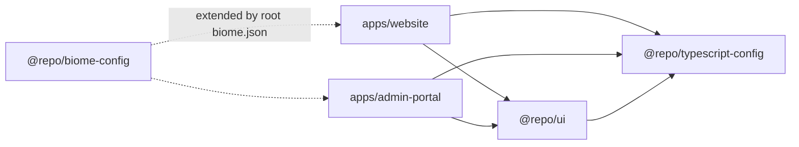
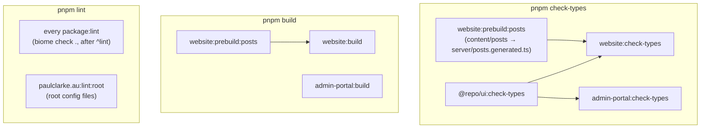

# paulclarke.au

[](https://github.com/pabloplico/paulclarke.au/actions/workflows/ci.yml)

A pnpm + NX monorepo with two apps:

- **My developer portfolio** (`apps/website`): projects, an AI readiness assessment demo, writing and contact. A React SPA plus a small Hono API, deployed as one Cloudflare Worker.
- **A document workspace platform** (`apps/admin-portal`): upload documents, have them parsed and routed into structured workspaces, and edit sections with AI, previewing each change as a diff. Next.js with Postgres, Redis job queues and the Vercel AI SDK. It can also run with no other services: an embedded Postgres (PGlite) and in-process queues.

Both are written in strict TypeScript and share UI and tooling packages.

## What's in here

| Path                         | What it is                                                                    | Stack                                                                                          |
| ---------------------------- | ----------------------------------------------------------------------------- | ---------------------------------------------------------------------------------------------- |
| `apps/website`               | Developer portfolio                                                           | React 19, Vite, TanStack Router + Query, Tailwind v4, Hono on Cloudflare Workers               |
| `apps/admin-portal`          | Document workspace platform                                                   | Next.js 16, Drizzle + Postgres/pgvector or PGlite, BullMQ + Redis or in-process queues, AI SDK |
| `packages/ui`                | Shared React components (`@repo/ui/button`, …)                                | React, Tailwind, Radix primitives                                                              |
| `packages/typescript-config` | Shared `tsconfig` presets: `base` (strict), `vite`, `nextjs`, `react-library` | TypeScript                                                                                     |
| `packages/biome-config`      | Shared lint and format rules                                                  | Biome                                                                                          |
| `packages/prettier-config`   | Markdown formatting                                                           | Prettier                                                                                       |

## Architecture

### Workspace dependencies



Apps import shared code by package name (`@repo/ui/button`), never by relative path across packages. The `ui` package is consumed as TypeScript source and compiled by each app's bundler, so there is no separate build step for it.

### NX task graph

Each package declares its own `lint`, `check-types`, `test` and `build` scripts, and NX runs them as targets. `nx.json` says how the targets relate and what each one reads and writes. NX runs them in dependency order, in parallel where it can, and caches the results by their inputs.



- `check-types` depends on `^check-types` (the `^` means "in my dependencies first"), so `@repo/ui` is checked before the apps that import it.
- The website's `build` and `check-types` both depend on `prebuild:posts`. It turns the Markdown posts into a TypeScript module that the Worker imports, and it's cached, so it only re-runs when a post or the script changes.
- `lint:root` belongs to the root project and covers config files that no package owns.
- `pnpm test` and `pnpm test:e2e` have no task dependencies.

### Why NX and what changed

The repo moved from Turborepo to NX in its first pull request. The task graph, the script names and the developer commands are unchanged; NX now runs them.

- **Why:** NX treats the workspace as a project graph, not just a list of packages. That gives `nx affected` (CI checks only what a change can break), `nx graph` to see the structure, and room to grow into generators and module-boundary rules.
- **No plugins yet.** Each target is the package's own `package.json` script, so the migration changed the task runner and nothing else. Caching therefore relies on explicit `inputs` and `outputs` in `nx.json` rather than on plugin inference. A `production` input excludes tests and specs, so editing a test doesn't invalidate a build.
- **Local cache only.** Nx Cloud is turned off (`neverConnectToCloud`), and CI uses no remote cache.
- **CI:** pull requests run `nx affected` against their merge base with `main`; pushes to `main` run everything.

| Task                       | Command                                             |
| -------------------------- | --------------------------------------------------- |
| One target in one project  | `pnpm exec nx run website:test`                     |
| What a target reads/writes | `pnpm exec nx show project website`                 |
| What a change affects      | `pnpm exec nx show projects --affected --base=main` |
| The project graph          | `pnpm exec nx graph`                                |
| Ignore the cache           | `pnpm exec nx run-many -t test --skip-nx-cache`     |
| Clear the cache            | `pnpm exec nx reset`                                |

## Getting started

Requirements: Node 22 and pnpm 10.28 (`corepack enable` picks up the version from `package.json`). Docker is optional.

```bash
pnpm install

# Website: Vite on :3004, wrangler (Worker API) on :3005. Generates the blog
# posts first, then starts both
pnpm nx run website:dev

# Admin portal with nothing else running: Next.js on :3001, PGlite database
# in apps/admin-portal/.pglite, in-process jobs, sign-in off. A new database
# gets a dev user and a Getting Started workspace. Pass OPENAI_API_KEY (and
# AI_PROVIDER/AI_MODEL) in the environment for the AI features
pnpm nx run admin-portal:dev:lite

# Admin portal on the full stack: Postgres + Redis in Docker
cp .env.docker.example .env.docker      # then fill in values
cd apps/admin-portal
export COMPOSE_ENV_FILES=../../.env.docker   # compose reads its ${VARS} from here
docker compose up -d
```

The website needs no environment variables or secrets. Admin-portal settings are documented in `.env.docker.example` and `CLAUDE.md`.

## Common commands

Run from the repo root. NX runs each task in every project that defines it, and serves unchanged results from its cache.

```bash
pnpm lint           # Biome in every package + root config files
pnpm check-types    # tsc --noEmit in admin-portal, website and @repo/ui
pnpm test           # Vitest unit tests (website + admin-portal)
pnpm build          # production builds

pnpm --filter website test:e2e   # Playwright + axe against the production build
```

## Testing

- **Unit tests:** 1,098 across both apps (1,046 admin-portal, 52 website).
- **Website E2E:** Playwright on a desktop and a mobile viewport.
- **Accessibility:** automated checks with axe on every website page.

CI runs it all except admin-portal E2E, which needs Postgres and Redis. It also builds a fresh database from the migrations and checks it matches the schema. See [TESTING.md](TESTING.md) for what each suite covers and how the mocks work.

## Deployment

**Website (Cloudflare Workers).** One Worker serves the SPA through the Static Assets binding, plus a small `/api/posts` endpoint for the blog:

```bash
cd apps/website
pnpm deploy           # nx run website:build (posts + vite build), then wrangler deploy
pnpm deploy:dry-run   # build and bundle without uploading
```

- **Deep links:** `wrangler.jsonc` sets `not_found_handling: "single-page-application"`, so browser navigations to paths like `/writing/my-post` get `index.html` and the client router takes over. These navigations don't invoke the Worker script. `/api/*` always runs the Worker (`run_worker_first`).
- **Security headers:** the CSP and other headers are in `public/_headers`. The Worker never sees page navigations, so headers set in Worker code wouldn't reach the pages.

**Admin portal (Docker).** A multi-stage image with Next.js `output: 'standalone'`:

```bash
docker build -t admin-portal -f apps/admin-portal/Dockerfile .
```

## Decisions

**Cloud Run → Cloudflare Workers (website).** The website is a static SPA with a read-only blog API, so a container on Cloud Run was paying for a server that did almost nothing.

- **Why Workers:** one Worker serves the assets from the edge, runs the tiny API, costs nothing at this traffic, and leaves no container image or region to manage.
- **Costs:** local dev needs `workerd`, which is glibc-only, so the dev container uses `node:22-slim` rather than Alpine. And the Worker doesn't run on page navigations, which is why security headers moved to `_headers`.

**`mailto:` instead of a form backend.** The contact form builds a pre-filled `mailto:` link.

- **Considered first:** a hosted email API with a CAPTCHA. It needs secrets, a paid plan at real volume, and spam handling, all for a low-traffic form.
- **What `mailto:` gives:** no backend, no secrets, nothing for bots to post to, and the visitor keeps a copy in their own sent mail.
- **Trade-off:** it relies on the visitor having a mail client, so the confirmation screen also shows the address to copy.
- **Same thinking elsewhere:** the assessment's "Download as PDF" uses the browser's print dialog and a print stylesheet instead of a PDF service.

**NX over Turborepo, without plugins (for now).** Turborepo got the repo cached, dependency-aware tasks quickly. NX adds `nx affected` for CI and a project graph, and the concepts map closely, so the move was mostly configuration (see "Why NX and what changed").

- **Why no plugins yet:** NX plugins (`@nx/vite`, `@nx/next`, `@nx/playwright`) can infer targets from tool configs, but they replace the package scripts and bring their own dependencies. Keeping the scripts meant the migration changed only the task runner: each target is still a plain script you can read in `package.json`. The one exception is the website's posts step, now its own target that `build` and `check-types` depend on.
- **Cost:** cache inputs and outputs are written by hand in `nx.json`, so a new tool's config file has to be added there. Plugins are the natural next step.

**Admin-portal demo: one container, a gate, and real AI with caps.** The admin portal is being prepared as a public demo.

- **No external services:** `DB_DRIVER=pglite` and `QUEUE_DRIVER=memory` run the database and job queues inside the Node process, so the demo is one container on one instance. Postgres and Redis remain the default, behind the same interfaces.
- **Cloudflare Access instead of demo logins:** visitors will sign in with a one-time email PIN. The app verifies the signed Access token on every request and gives each email its own member account.
- **Real AI, capped:** every model call goes through one guard with an output-token cap, daily spend caps in total and per user, and a per-user rate limit. A test checks that every route that starts AI work applies it. The provider's hard spend limit is the final backstop.
- **`DEMO_MODE=true`** switches off backups, settings, feeds, research agents and URL ingestion. Every route is listed as on or off, and a test fails if a new one isn't.

**Allow-list `COPY` in Docker.** The admin image used `COPY . .`. `.dockerignore` patterns only match from the repo root, so nested `node_modules`, `.next`, `uploads`, local database dumps and a service-account key were all in the build context: over 720 MB, and the build failed reading a root-owned folder.

- **The fix:** the Dockerfile now copies only the manifests, `packages/` and `apps/admin-portal/`, and `.dockerignore` uses `**/` patterns.
- **Result:** the context is 6 MB, and a new secret file is excluded by default instead of included by default.

## More

- [`TESTING.md`](TESTING.md): test suites, coverage and mocking patterns
- [`CLAUDE.md`](CLAUDE.md): detailed setup, Docker dev environments and conventions (also used by Claude Code)

## Licence

Code is [MIT](LICENSE). The photo in `apps/website/public/images/hs2.jpg` and the blog posts in `apps/website/content/posts/` aren't covered by the MIT licence; please don't reuse them.
