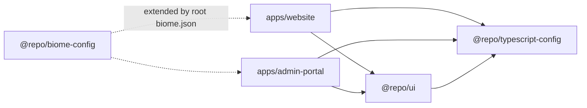
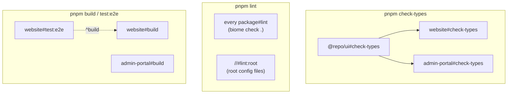

# paulclarke.au

[](https://github.com/pabloplico/paulclarke.au/actions/workflows/ci.yml)

A pnpm + Turborepo monorepo with two apps:

- **My developer portfolio** (`apps/website`): projects, an AI readiness assessment demo, writing and contact. A React SPA plus a small Hono API, deployed as one Cloudflare Worker.
- **A document workspace platform** (`apps/admin-portal`): upload documents, have them parsed and routed into structured workspaces, and edit sections with AI, previewing each change as a diff. Next.js with Postgres, Redis job queues and the Vercel AI SDK.

Both are written in strict TypeScript and share UI and tooling packages.

## What's in here

| Path                         | What it is                                                                    | Stack                                                                            |
| ---------------------------- | ----------------------------------------------------------------------------- | -------------------------------------------------------------------------------- |
| `apps/website`               | Developer portfolio                                                           | React 19, Vite, TanStack Router + Query, Tailwind v4, Hono on Cloudflare Workers |
| `apps/admin-portal`          | Document workspace platform                                                   | Next.js 16, Drizzle + Postgres/pgvector, BullMQ + Redis, AI SDK                  |
| `packages/ui`                | Shared React components (`@repo/ui/button`, …)                                | React, Tailwind, Radix primitives                                                |
| `packages/typescript-config` | Shared `tsconfig` presets: `base` (strict), `vite`, `nextjs`, `react-library` | TypeScript                                                                       |
| `packages/biome-config`      | Shared lint and format rules                                                  | Biome                                                                            |
| `packages/prettier-config`   | Markdown formatting                                                           | Prettier                                                                         |

## Architecture

### Workspace dependencies



Apps import shared code by package name (`@repo/ui/button`), never by relative path across packages. The `ui` package is consumed as TypeScript source and compiled by each app's bundler, so there is no separate build step for it.

### Turborepo task graph

Each package declares its own `lint`, `check-types`, `test` and `build` scripts. `turbo.json` says how the tasks relate, and Turborepo runs them in dependency order, in parallel where it can, caching results by their inputs.



- `check-types` depends on `^check-types` (the `^` means "in my dependencies first"), so `@repo/ui` is checked before the apps that import it.
- `//#lint:root` is a root-package task that covers config files belonging to no package.
- A second run with no changes is served from Turbo's cache.

### Parallels with NX

The concepts map almost one to one. Migrating this repo to NX is planned.

| Turborepo (here)                         | NX equivalent                                            |
| ---------------------------------------- | -------------------------------------------------------- |
| Package `scripts` + `turbo.json` `tasks` | Project `targets` + `targetDefaults`                     |
| `"dependsOn": ["^build"]`                | `"dependsOn": ["^build"]` (same syntax)                  |
| `inputs` / `outputs` for caching         | `inputs` / `outputs`, named inputs                       |
| `turbo run test --filter=website`        | `nx run website:test` / `nx run-many -t test -p website` |
| `--affected`                             | `nx affected -t test`                                    |
| pnpm workspaces for linking              | pnpm workspaces (or NX's own project graph)              |
| (none)                                   | Generators, module-boundary lint rules, project graph UI |

## Getting started

Requirements: Node 22 and pnpm 10.28 (`corepack enable` picks up the version from `package.json`). Docker is needed for the admin portal.

```bash
pnpm install

# Website: Vite on :3004, wrangler (Worker API) on :3005
cd apps/website && pnpm dev

# Admin portal: Next.js on :3001 with Postgres + Redis in Docker
cp .env.docker.example .env.docker      # then fill in values
cd apps/admin-portal && docker compose up -d
```

The website needs no environment variables or secrets. Admin-portal settings are documented in `.env.docker.example` and `CLAUDE.md`.

## Common commands

Run from the repo root. Turborepo runs each task in every package that defines it.

```bash
pnpm lint           # Biome in every package + root config files
pnpm check-types    # tsc --noEmit in admin-portal, website and @repo/ui
pnpm test           # Vitest unit tests (website + admin-portal)
pnpm build          # production builds

pnpm --filter website test:e2e   # Playwright + axe against the production build
```

## Testing

- **Unit tests:** about 970 across both apps.
- **Website E2E:** Playwright on a desktop and a mobile viewport.
- **Accessibility:** automated checks with axe on every website page.

CI runs it all except admin-portal E2E, which needs Postgres and Redis. See [TESTING.md](TESTING.md) for what each suite covers and how the mocks work.

## Deployment

**Website (Cloudflare Workers).** One Worker serves the SPA through the Static Assets binding, plus a small `/api/posts` endpoint for the blog:

```bash
cd apps/website
pnpm deploy           # vite build + wrangler deploy
pnpm deploy:dry-run   # build and bundle without uploading
```

- **Deep links:** `wrangler.jsonc` sets `not_found_handling: "single-page-application"`, so browser navigations to paths like `/writing/my-post` get `index.html` and the client router takes over. These navigations don't invoke the Worker script. `/api/*` always runs the Worker (`run_worker_first`).
- **Security headers:** the CSP and other headers are in `public/_headers`. The Worker never sees page navigations, so headers set in Worker code wouldn't reach the pages.

**Admin portal (Docker).** A multi-stage image with Next.js `output: 'standalone'`:

```bash
docker build -t admin-portal -f apps/admin-portal/Dockerfile .
```

## Decisions

**Cloud Run → Cloudflare Workers (website).** The website is a static SPA with a read-only blog API, so a container on Cloud Run was paying for a server that did almost nothing.

- **Why Workers:** one Worker serves the assets from the edge, runs the tiny API, costs nothing at this traffic, and leaves no container image or region to manage.
- **Costs:** local dev needs `workerd`, which is glibc-only, so the dev container uses `node:22-slim` rather than Alpine. And the Worker doesn't run on page navigations, which is why security headers moved to `_headers`.

**`mailto:` instead of a form backend.** The contact form builds a pre-filled `mailto:` link.

- **Considered first:** a hosted email API with a CAPTCHA. It needs secrets, a paid plan at real volume, and spam handling, all for a low-traffic form.
- **What `mailto:` gives:** no backend, no secrets, nothing for bots to post to, and the visitor keeps a copy in their own sent mail.
- **Trade-off:** it relies on the visitor having a mail client, so the confirmation screen also shows the address to copy.
- **Same thinking elsewhere:** the assessment's "Download as PDF" uses the browser's print dialog and a print stylesheet instead of a PDF service.

**Turborepo now, NX next.** Turborepo was the quickest way to get cached, dependency-aware tasks over pnpm workspaces. It's one small `turbo.json` and package scripts that still work without it. NX adds generators, module-boundary rules and a richer project graph, which pays off as the repo grows. The concepts map closely (table above), so moving is mostly configuration.

**Allow-list `COPY` in Docker.** The admin image used `COPY . .`. `.dockerignore` patterns only match from the repo root, so nested `node_modules`, `.next`, `uploads`, local database dumps and a service-account key were all in the build context: over 720 MB, and the build failed reading a root-owned folder.

- **The fix:** the Dockerfile now copies only the manifests, `packages/` and `apps/admin-portal/`, and `.dockerignore` uses `**/` patterns.
- **Result:** the context is 6 MB, and a new secret file is excluded by default instead of included by default.

## More

- [`TESTING.md`](TESTING.md): test suites, coverage and mocking patterns
- [`CLAUDE.md`](CLAUDE.md): detailed setup, Docker dev environments and conventions (also used by Claude Code)

## Licence

Code is [MIT](LICENSE). The photo in `apps/website/public/images/hs2.jpg` and the blog posts in `apps/website/content/posts/` aren't covered by the MIT licence; please don't reuse them.
